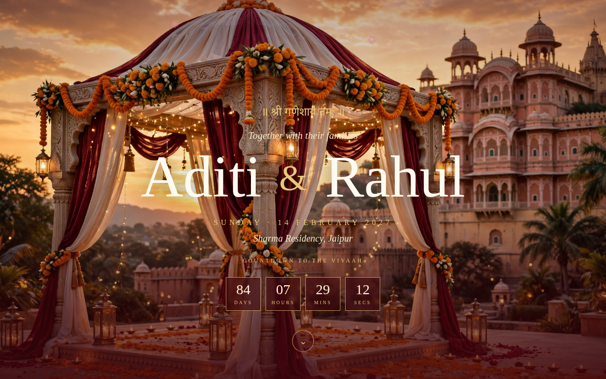

# Wedding Invitation Website

A maroon-and-gold **digital wedding invitation** website.

- Tap-to-open gate — the invitation card opens top to bottom
- Patrika scroll with the families' invitation
- Live countdown to the Vivaah
- Vivaah and Reception cards, gallery, venue details

## Preview

## Live demo

https://muse.ai/s/wedding-invitation-website-nxa6zlxdxmyxnxg5/RyG_WSaj8v4XDa21SQGDo6gCDMXB-ZrOA4HQ5I9Fn68

> Note: the site uses sample details (Aditi & Rahul, Sharma Residency, Jaipur, 14–15 February 2027) as placeholders — real couple details, date, venue and photos are added per wedding.

## Tech

HTML, CSS, JavaScript — single-file site (`index.html`).

## License

MIT — see [LICENSE](LICENSE).
